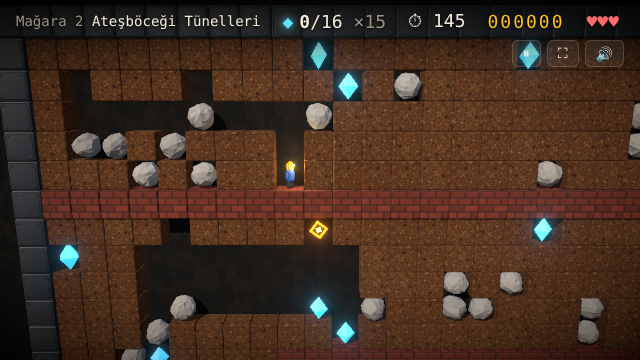
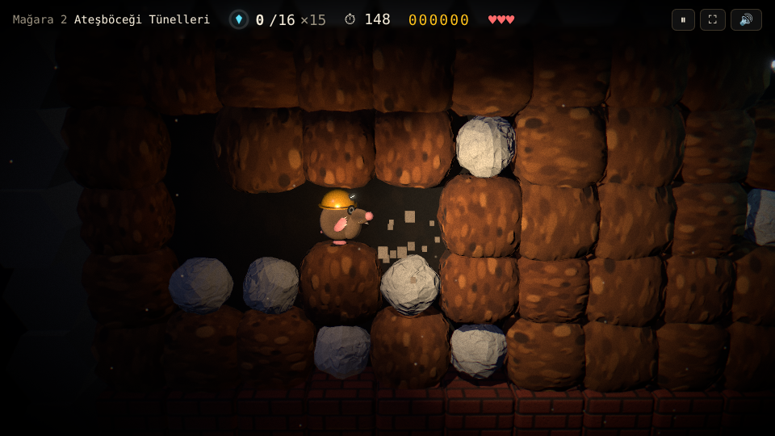
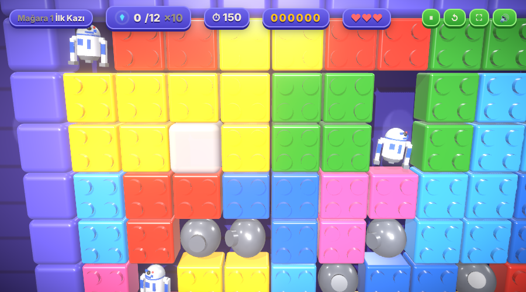

# Mister Mole

<p align="center"><b>Demo:</b> <a href="https://billylz.github.io/r3f-mister-mole/">https://billylz.github.io/r3f-mister-mole/</a></p>

1980'lerin klasik maden oyunlarından esinlenen, React Three Fiber ile yazılmış 3B bir maden oyunu. Grafikler, sesler ve mağaralar bu projeye özgüdür; hiçbir oyundan varlık kopyalanmamıştır.



## Sürümler

Ana menüden üç görünüm arasında seçim yapılır; seçim tarayıcıda hatırlanır. Oyun kuralları ve mağaralar tüm sürümlerde aynıdır.

- **Sürüm 1 · Klasik:** aydınlık mağara, blok toprak, madenci karakter.
- **Sürüm 2 · Modern** (`src/v2/`): karanlık mağara. Işığı köstebeğin gölge düşüren kafa lambası, elmaslar, ateşböcekleri ve patlamalar verir. Ayrıca:
  - birbirine kaynayan organik toprak, bazalt sütunlar, pırlanta kesimli yanardöner elmaslar;
  - havada süzülen toz zerreleri, patlamada şok dalgası ve kısa ağır çekim;
  - düşen nesnelerde esneme-sıkışma, ileriye bakan kamera, telefonda titreşim;
  - elmas ilerleme halkası ve süre azalınca kırmızı nabız atan ekran kenarları.



- **Sürüm 3 · Oyuncak tuğla** (`src/v3/`): aydınlık mor sahne ve canlı renkli, düğmeli plastik tuğlalar. Ayrıca:
  - kayalar düğmeli gri toplar, çerçeve mor karolar; toplanacak elmaslar yerine kubbe başlı küçük robotlar var (kafaları sağa sola bakar);
  - sabit duvarlar uçları yuvarlak, delikli tek parça kirişler;
  - oyuncu 2,5 saniye durursa çıkış noktasından halka halka yayılan yumuşak bir dalga başlar: her tuğla bütün olarak Z ekseninde ileri geri gider, sabit duvarlar ve çerçeve yerinde kalır (hareket edince söner);
  - açılan çıkış beyaz oklu kırmızı bir karo;
  - kazılan tuğla kendi renginde parçalara, patlamalar rengarenk tuğla parçalarına ayrılır;
  - karakter, kara kasklı, pelerinli ve kırmızı enerji kılıçlı oyuncak figür **Kara Lord**. Robota ulaşınca kılıcını savurur: sıfırdan sentezlenen kılıç sesi, beyaz çekirdekli kırmızı ışıma ve çevreye saçılan kırmızı ışık.



## Özellikler

- **Motor** (`src/engine.ts`): render'dan bağımsız, deterministik TypeScript. Klasik maden oyunlarındaki gibi ızgara her tick'te yukarıdan aşağıya, soldan sağa taranır. Taşlar ve elmaslar düşer, yuvarlak nesnelerin üstünden yuvarlanır. Ateşböcekleri sol duvarı, kelebekler sağ duvarı takip eder. Ayrıca amip, sihirli duvar, 3×3 patlamalar, taş itme ve "yerinde kazma" vardır.
- **Mağaralar** (`src/levels.ts`): klasik oyunlardaki gibi tohumlu rastgele dolgu üzerine çizim komutlarıyla üretilen 6 mağara.
- **Görünüm**: instanced mesh'ler, iki tick arasında yumuşak hareket, gölgeler, bloom, parçacıklar, kafa lambalı madenci, kamera takibi ve sarsıntı. Sesler Web Audio ile sentezlenir. Dokunmatik ekranlar için yön tuşları vardır.

## Çözüm düğmesi

Sağ üstteki **💡 Çözüm** düğmesi (kısayol **H**) üç sürümde de çalışır: o anki durumdan mağaranın çözümünü bulur, karakterin gideceği yolu parlak noktalarla çizer ve hamleleri kendisi yapar. **■ Durdur** ya da herhangi bir yön tuşu kontrolü oyuncuya geri verir.

Çözücü (`src/solver.ts`) oyunun kopyasını motorla adım adım ileri simüle eder; motor belirlenimci olduğu için bulunan hamleler gerçek oyunda aynen oynanınca aynı sonucu verir. Aranan hamleler: en yakın elmasa en kısa yoldan gitmek (her adım simüle edilir, ölümle biten adımlar elenir), taş itmek, altındaki toprağı yandan kazarak taş düşürmek (kelebek ezmek ya da sihirli duvardan elmas elde etmek için) ve tıkanan yolları açmak için keşif. Çıkmaz sokakta geri dönülür. Arama ayrı bir iş parçacığında (Web Worker) çalışır, en fazla 10 saniye sürer.

Testler 6 varsayılan mağaranın hepsinin çözüldüğünü ve çözümün tekrar oynatılınca kazandığını doğrular. Başka harita tohumlarında çözücü her zaman çözüm bulamayabilir; bulamazsa bunu söyler.

## Harita tohumu

Mağaralar orijinal oyundaki gibi tohumlu rastgele dolgu ile üretilir: aynı tohum her seferinde aynı haritayı verir. Ana menüdeki **Harita tohumu** kutusu:

- **Boş (varsayılan):** her mağara kendi tasarlanmış haritasıyla açılır.
- **Bir sayı:** 1. mağara o sayıyı, sonraki her mağara 101 fazlasını tohum olarak kullanır. Varsayılan tohumlar 101, 202, 303, 404, 505, 606 olduğu için **101** girmek varsayılan haritaları verir. Aynı sayıyı giren herkes aynı haritaları alır.
- **🎲** rastgele bir tohum seçer, **Varsayılan** geri döner. Seçim tarayıcıda hatırlanır; duraklatma menüsünde o mağaranın tohumu görünür.

Başka bir tohum yeterli elmas vermezse eksik elmaslar rastgele toprak hücrelere eklenir, böylece her harita bitirilebilir kalır.

## Kontroller

| Tuş | İşlev |
| --- | --- |
| Ok tuşları / WASD | Hareket |
| Shift + yön | Yerinden kıpırdamadan kaz veya al |
| Esc | Sıkışınca mağarayı baştan al (bir can gider). Telefonda üstteki ↺ düğmesi |
| P | Duraklat |
| V | Genel görünüm |
| M | Ses aç/kapat |
| Fare tekerleği | Yakınlaştır/uzaklaştır |

## Çalıştırma

```bash
npm install
npm run dev     # http://localhost:5173
npm test        # oyun kuralları ve mağara kontrolleri
npm run build
```

Testler (`scripts/check-game.ts`) düşme, yuvarlanma, ezilme, toplama, itme, düşman hareketi, kelebek elmasları, sihirli duvar, amip ve süre kurallarını kontrol eder. Her mağara için de gerekli elmas sayısına ulaşılabildiğini, düşmanların kendiliğinden ölmediğini ve rastgele oynanışta çökme olmadığını doğrular.

## Demo yayını (GitHub Pages)

`.github/workflows/pages.yml` her push'ta testleri çalıştırır ve projeyi derler. Varsayılan dala yapılan push'larda `dist/` klasörünü GitHub Pages'e yayınlar. Bunun için **Settings → Pages → Source: GitHub Actions** seçilmelidir.
